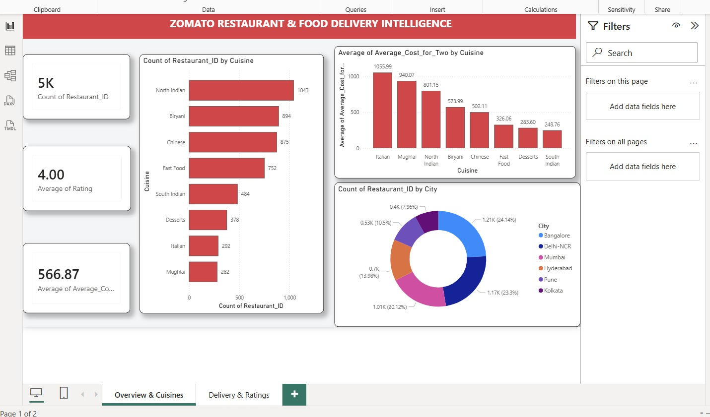
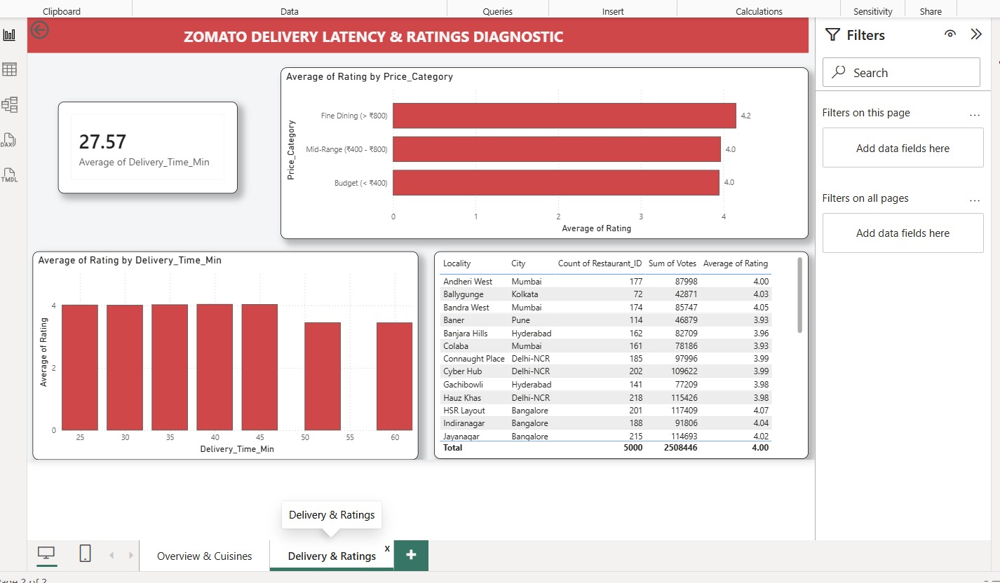

# Zomato Data Analytics Project

End-to-end data analytics project analyzing Zomato restaurant performance across cities, cuisines, pricing, and customer ratings using **Python**, **SQL (SQLite)**, and **Power BI**.

---

## Dashboard Preview

### Overview


### Detailed Analysis


---

## Business Objectives
- Identify top-performing cities, locations, and cuisines by restaurant count, votes, and ratings.
- Analyze how pricing (average cost for two) relates to customer ratings and popularity.
- Evaluate the impact of online delivery and table booking availability on restaurant performance.

---

## Tech Stack & Workflow
1. **Python (`generate_zomato_data.py`, `run_zomato_sql.py`):** Prepared the structured restaurant dataset (`zomato_restaurants_data.csv`), loaded it into SQLite (`zomato.db`), and automated SQL query execution.
2. **SQL (`01_zomato_schema.sql`, `02_zomato_queries.sql`):** Designed the relational schema and wrote analytical queries for city, cuisine, rating, and cost breakdowns.
3. **Power BI:** Built an interactive dashboard with KPI cards, filters, and visual breakdowns for executive insights.

---

## Key Insights
- **[Insight 1]:** *(Replace with a real finding from your dashboard, e.g., top city/cuisine and its % share or average rating)*
- **[Insight 2]:** *(Replace with a pricing/cost insight, e.g., most common price bracket and rating trend)*
- **[Insight 3]:** *(Replace with an online delivery / table booking insight with exact numbers from your Power BI visuals)*

---

## Repository Structure

```text
├── zomato_project/
│   ├── data/
│   │   ├── generate_zomato_data.py      # Dataset generation/preparation script
│   │   ├── zomato_restaurants_data.csv  # Raw/cleaned Zomato dataset
│   │   └── zomato.db                    # SQLite database
│   └── sql/
│       ├── 01_zomato_schema.sql         # Table schema definition
│       ├── 02_zomato_queries.sql        # Business analysis SQL queries
│       └── run_zomato_sql.py            # Script to run queries against zomato.db
├── powerbi1.png                         # Power BI dashboard screenshot 1
├── powerbi2.jpeg                        # Power BI dashboard screenshot 2
└── README.md                            # Project documentation
```

---

## How to Run Locally
1. Clone the repository:
   ```bash
   git clone https://github.com/Aditikaushal2004/ZOMATO-data-analytics.git
   cd ZOMATO-data-analytics
   ```
2. Run the Python scripts:
   ```bash
   python zomato_project/data/generate_zomato_data.py
   python zomato_project/sql/run_zomato_sql.py
   ```

---

## Author
**Aditi Kaushal**
- GitHub: [@Aditikaushal2004](https://github.com/Aditikaushal2004)
